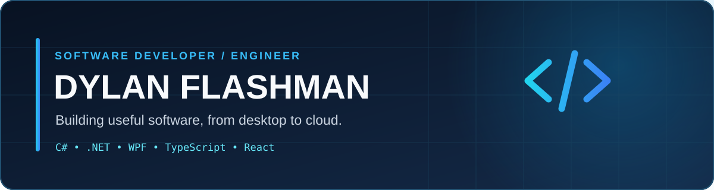

 

**Software Developer · Full-Stack & Desktop Applications · South Africa**

## 👋 About me

I'm Dylan, a developer with a background in **Computer Science and Applications Development**. I build desktop engineering tools, industrial automation software, and modern web applications. I enjoy turning complex workflows into dependable, intuitive products.

- 🔧 **At work:** C#, .NET, WPF, AutoCAD automation and data-driven tooling
- 🌐 **On the web:** React, Next.js, TypeScript, Node.js and APIs
- 📚 **Exploring:** Cloud architecture, developer tools, AI and fintech
- 🧠 **Interested in:** Well-designed systems, automation and practical engineering

## 🧰 Toolbox

**Languages**

**Applications & frameworks**

**Data & development tools**

## 🚀 What I'm building

| Project | Focus | Status |
| :--- | :--- | :--- |
| **Signal** | Investment portfolio tracking and analytics · Next.js, TypeScript, Supabase | 🛠️ In development |
| **KreskoCloud** | Cloud-oriented business management platform · .NET, Next.js, PostgreSQL | 🛠️ In development |
| **Engineering automation** | Desktop utilities for CAD workflows and industrial data · C#, .NET, WPF, SQLite | 🔒 Private/professional work |

> Some projects are private or still evolving. Public repositories and demos will be linked here as they become available. Professional project descriptions do not imply that proprietary source code is published.

## 📊 GitHub activity

Language cards reflect available public repositories, not all professional experience. External stat-card hosting may occasionally be unavailable.

---

**Build thoughtfully. Keep learning. Ship useful things.**

[Explore my repositories](https://github.com/DylanFlashman?tab=repositories) · [Follow on GitHub](https://github.com/DylanFlashman)

